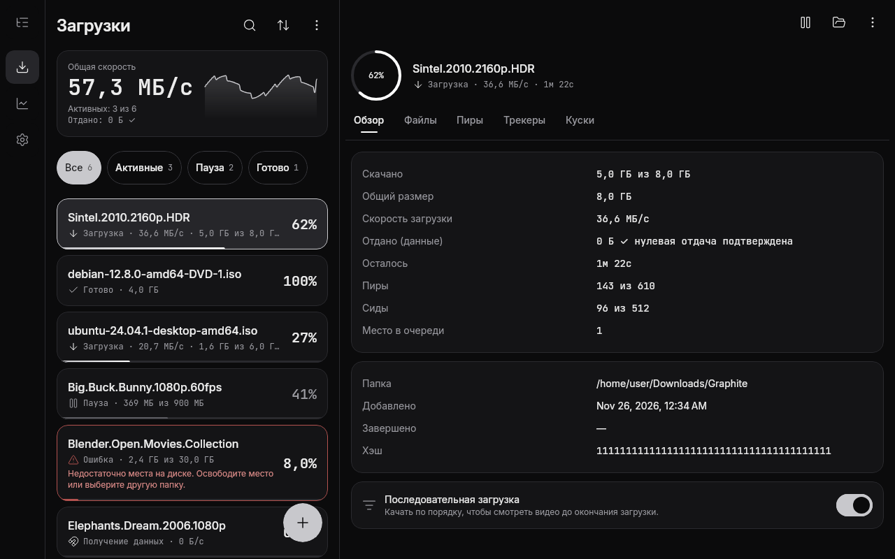
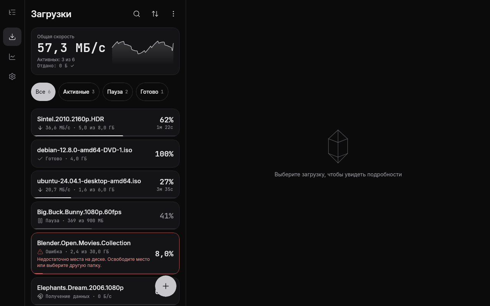
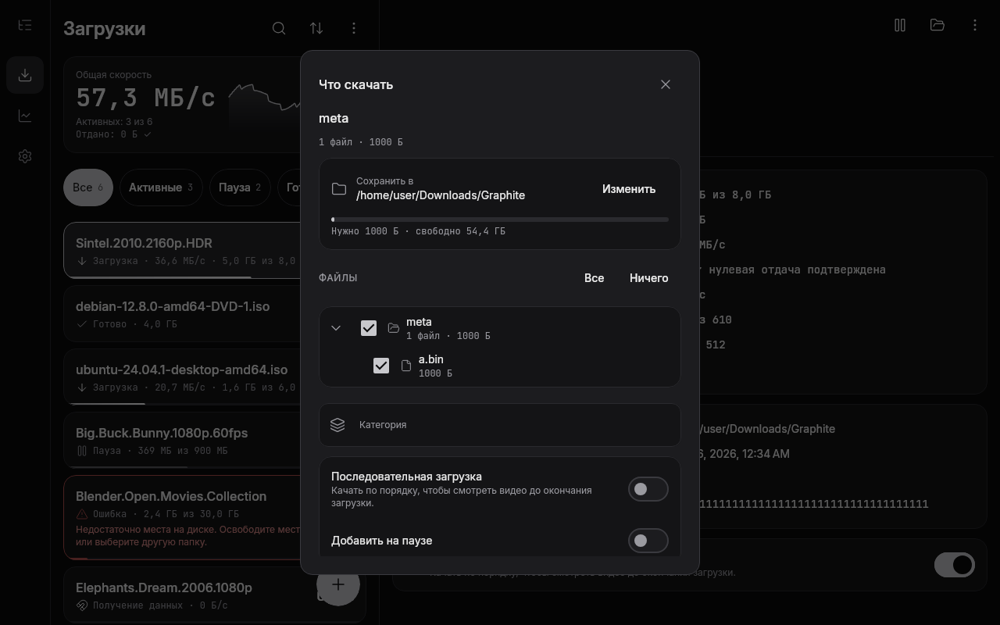
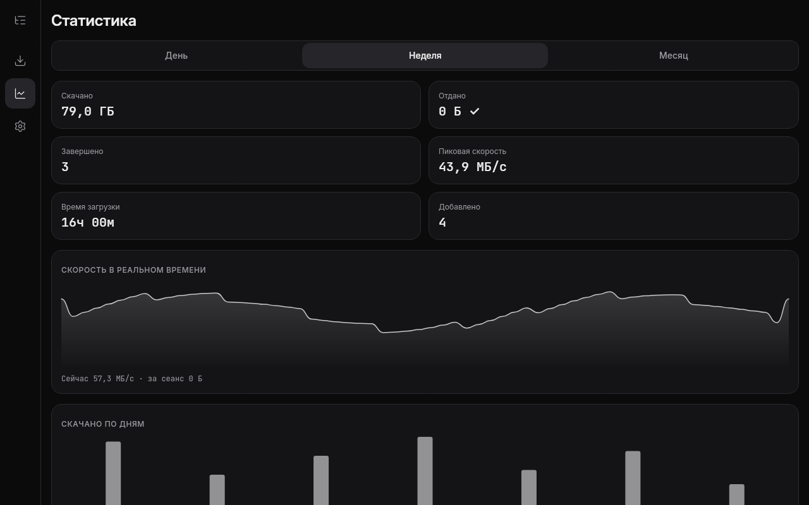
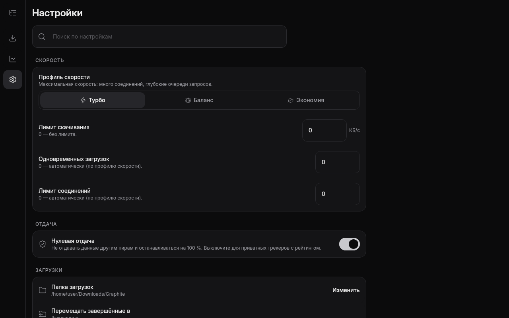
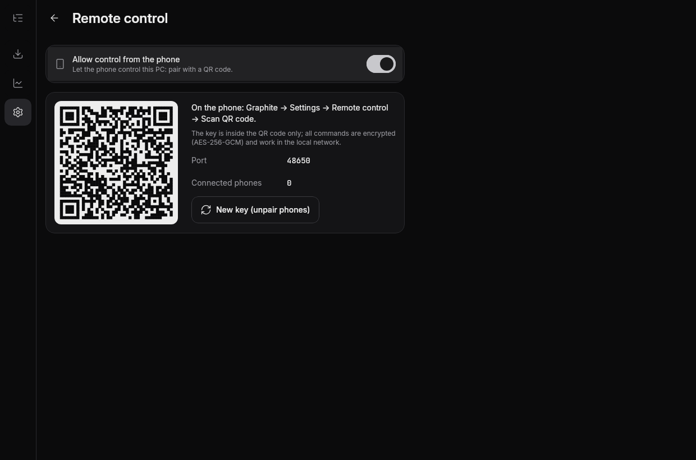
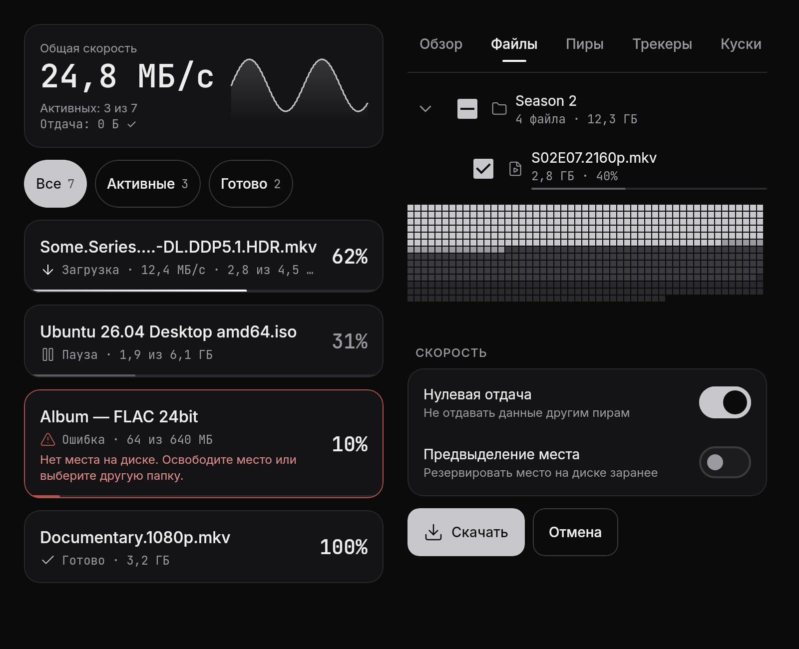

<p align="center"></p>

<h1 align="center">Graphite</h1>

<p align="center">Быстрый торрент-клиент для Windows и Android с общим кодом на Kotlin Multiplatform и Compose Multiplatform.<br>
Нулевая отдача по умолчанию, без рекламы, аналитики и сбора данных.</p>

<p align="center"></p>

## Возможности

**Добавление.** `.torrent` (диалог, перетаскивание, ассоциация файлов), magnet (ссылка, буфер обмена, протокол `magnet:`), QR-код (Android), «Поделиться» (Android), наблюдаемая папка, RSS. Перед загрузкой — предпросмотр: дерево файлов с выбором и приоритетами, папка, проверка свободного места.

**Управление.** Пауза / продолжение / удаление (с файлами или без), очередь с перетаскиванием, повторная проверка хэша, данные возобновления, перемещение после завершения, категории и теги, поиск, фильтры, сортировка, массовые действия.

**Скорость.** DHT, PEX, LSD, uTP + TCP, UPnP / NAT-PMP, веб-сиды, IPv6, автоматический выбор порта и проверка доступности, автообновляемый список публичных трекеров, предвыделение места, асинхронный диск. Профили «Турбо» (по умолчанию), «Баланс», «Экономия». Лимита скачивания по умолчанию нет.

**Нулевая отдача** (включена по умолчанию, отключается в настройках) — см. [как это устроено](#нулевая-отдача).

**Дополнительно.** Стриминг с последовательной загрузкой и встроенным плеером (libVLC на Windows, Media3 на Android); управление ПК с телефона в локальной сети (пара по QR, AES-256-GCM); планировщик; RSS с фильтрами; шифрование протокола, SOCKS5/HTTP-прокси, привязка к интерфейсу VPN с kill switch, IP-фильтр; действия после завершения (уведомление, звук, сон, выключение, выход); график скорости и статистика за день / неделю / месяц; журнал событий с понятными ошибками и советами; экспорт и импорт настроек и загрузок.

**Android:** foreground-сервис с прогрессом и кнопками, только Wi-Fi / только при зарядке / пауза при низком заряде, виджет, плитка быстрых настроек, Storage Access Framework.
**Windows:** MSI-установщик, трей, автозапуск, ассоциации `.torrent` и `magnet:`, мини-окно поверх всех, глобальные горячие клавиши, прогресс на панели задач, тёмный заголовок окна.

| | | |
|---|---|---|
|  |  |  |
|  |  |  |

## Сборка

### Что нужно

| | Версия |
|---|---|
| JDK | 21 (Temurin или любой другой) |
| Android SDK | platform 37 и build-tools Gradle (AGP) докачивает сам, если лицензии SDK приняты |
| Windows (только для MSI) | Windows 10/11 x64; WiX Toolset Compose Multiplatform скачивает сам |
| Gradle | через `./gradlew` (9.9.2) |

Все версии библиотек — в [`gradle/libs.versions.toml`](gradle/libs.versions.toml).

### Команды

```bash
# Тесты (core, data, UI, desktop)
./gradlew :core:desktopTest :data:desktopTest :ui:designsystem:desktopTest :ui:app:desktopTest :platform:desktop:test

# Android: отладочные и релизные APK (по ABI + universal)
./gradlew :platform:android:assembleDebug
./gradlew :platform:android:assembleRelease
#   → platform/android/build/outputs/apk/{debug,release}/

# Запуск desktop-версии из исходников (Windows, Linux; macOS не проверялся)
./gradlew :platform:desktop:run

# MSI (только на Windows)
./gradlew :platform:desktop:packageMsi
#   → platform/desktop/build/compose/binaries/main/msi/Graphite-1.0.0.msi
```

**Подпись релизного APK.** Задайте переменные окружения `GRAPHITE_KEYSTORE_FILE`, `GRAPHITE_KEYSTORE_PASSWORD`, `GRAPHITE_KEY_ALIAS`, `GRAPHITE_KEY_PASSWORD`. Без них релизный APK подписывается отладочным ключом (годится для проверки, не для публикации).

**libVLC для MSI.** Встроенный плеер ищет libVLC сначала внутри установленного приложения, затем в установленном VLC. Чтобы положить его в MSI, перед `packageMsi` распакуйте [VLC 3.0.x win64 zip](https://download.videolan.org/pub/videolan/vlc/) и скопируйте `libvlc.dll`, `libvlccore.dll`, `COPYING.txt` и папку `plugins` в `platform/desktop/resources/windows/vlc/` (папка в `.gitignore`). CI делает это сам. Без libVLC приложение работает, плеер предлагает открыть поток во внешнем приложении.

**Linux.** libtorrent4j подменяет обработчик SIGSEGV, поэтому JVM на Linux запускается с `LD_PRELOAD=$JAVA_HOME/lib/libjsig.so` — Gradle-задачи `run` и `test` делают это автоматически. На Windows (целевая платформа) это не нужно.

**Проверка запуска на Android.** `tools/android_smoke_test.sh <apk>` ставит APK на подключённый эмулятор или телефон, запускает Graphite и проверяет, что процесс жив, первый экран показан и в журнале нет падений. Запускайте её на **релизном** APK: ошибки R8 и падения в инициализаторах библиотек не видны в JVM-тестах (так однажды уже было: старый WorkManager, который тянет Glance, падал в релизе до старта приложения).

### CI

[`.github/workflows/build.yml`](.github/workflows/build.yml) на каждый коммит: тесты на Ubuntu, APK на Ubuntu, запуск релизного APK на эмуляторе Android 14 (если приложение не стартует, задача падает; на раннерах без аппаратного ускорения проверка пропускается с предупреждением), MSI на Windows (с libVLC). Артефакты: `graphite-android`, `graphite-windows`, `test-reports`. Для подписанного релиза добавьте секреты `GRAPHITE_KEYSTORE_BASE64`, `GRAPHITE_KEYSTORE_PASSWORD`, `GRAPHITE_KEY_ALIAS`, `GRAPHITE_KEY_PASSWORD`.

## Архитектура

```
core                 модели, движок (libtorrent4j), настройки libtorrent, magnet, RSS, планировщик, ошибки
 └─ data             SQLDelight (загрузки, история, статистика, журнал, RSS, расписание), DataStore (настройки),
     │               LocalTorrentController, автоматизация, стриминг, удалённое управление, бэкап
     └─ ui:app       экраны и ViewModel (MVVM, StateFlow), навигация, ресурсы ru/en
         └─ ui:designsystem   GraphiteTheme (токены), компоненты, иконки, шрифты
platform:android     Activity, foreground-сервис, SAF, ExoPlayer, виджет, плитка, сканер QR
platform:desktop     окно, трей, MSI, реестр Windows (автозапуск, ассоциации), горячие клавиши, libVLC
testing              фейковый движок для тестов data и UI (в приложения не попадает)
```

- **Один контроллер на всё.** UI работает только с интерфейсом `TorrentController`. На ПК это `LocalTorrentController` поверх libtorrent; на телефоне `SwitchableTorrentController` переключает весь интерфейс между локальным движком и сопряжённым ПК (`RemoteTorrentController`), экраны об этом не знают.
- **Потоки данных.** Движок публикует состояние раз в секунду (`StateFlow`), события — через `SharedFlow`; контроллер объединяет живые загрузки с архивными (завершёнными и перенесёнными в SAF), пишет историю, статистику и журнал.
- **Тема.** Все цвета, размеры, радиусы, отступы и длительности анимаций — в `GraphiteTheme` (`ui/designsystem/.../theme`). Каждый компонент — отдельная функция с `@Preview`.

### Нулевая отдача

Когда включено (по умолчанию):

1. `unchoke_slots_limit = 0` — ни один пир не получает разрешения скачивать у нас. При нуле слотов libtorrent не делает и optimistic unchoke.
2. `allowed_fast_set_size = 0` — не раздаём «allowed fast»-куски, которые можно скачать без unchoke.
3. Фильтр классов пиров переводит **все** адреса IPv4/IPv6 (включая локальную сеть) в глобальный класс: иначе локальные пиры попадают в класс, на который лимит слотов не действует.
4. `upload_rate_limit` **не** ставится в минимальное значение: в libtorrent этот лимит режет все исходящие байты, включая наши запросы кусков, и замедлил бы скачивание. При нуле слотов он и не нужен.
5. `active_seeds = 0`, `seeding_outgoing_connections = false`; на 100 % загрузка снимается с авто-управления и ставится на паузу — раздачи не бывает.
6. В интерфейсе показывается **отданный полезный трафик** (`total_payload_upload`) — он равен 0. Служебный трафик протокола (рукопожатия, запросы, `have`) не равен нулю и не может быть, он к «отдаче» не относится.

Это проверено интеграционным тестом `EngineIntegrationTest`: три настоящие сессии libtorrent на localhost — сидер, Graphite и посторонний личер. Graphite скачивает файл полностью, личер не получает от него ни одного байта данных, после 100 % раздача не начинается.

Для приватных трекеров с обязательным рейтингом нулевую отдачу нужно выключить.

### Скорость и диск

| Параметр libtorrent | Турбо | Баланс | Экономия |
|---|---|---|---|
| `connections_limit` | 800 | 400 | 120 |
| `max_out_request_queue` | 1500 | 600 | 250 |
| `connection_speed` | 200 | 60 | 15 |
| `torrent_connect_boost` | 100 | 40 | 10 |
| буферы сокетов | 1 МБ | 512 КБ | системные |
| `max_queued_disk_bytes` | 64 МБ | 32 МБ | 8 МБ |
| `aio_threads` | 2 × ядер (4…32) | ядер (2…16) | 2 |
| `hashing_threads` | ядер (2…16) | ядер / 2 (1…8) | 1 |
| активных загрузок | 8 | 5 | 3 |

Лимиты соединений и загрузок, размер дисковой очереди можно переопределить в настройках. **Про кэш:** в libtorrent 2.x собственного дискового кэша больше нет — данные идут через страничный кэш ОС (mmap). Поэтому «кэш» в настройках — это размер очереди записи (`max_queued_disk_bytes`) и выбор бэкенда (mmap или pread/pwrite) и режима записи.

### Экономия заряда и работа в фоне (Android)

- Состояние загрузок движок сообщает сам и только об изменившихся торрентах (`post_torrent_updates` → `state_update_alert`) — простаивающие торренты не опрашиваются; файлы возобновления пишутся, только если что-то изменилось.
- Фоновая служба работает, пока есть что делать: идёт загрузка, проверка, перенос файлов, либо загрузки ждут условия (Wi-Fi, зарядка, расписание). Пауза, поставленная вручную, службу останавливает.
- Процессор и Wi-Fi удерживаются от сна только пока идут данные. Если 10 минут не получено ни байта (нет сидов) или загрузки ждут условия, телефону разрешается уснуть; раз в ~15 минут он просыпается на 45 секунд, чтобы проверить расписание и поискать пиры заново. Следствие: правило расписания во сне может сработать с опозданием до 15 минут.
- Уведомление обновляется только при изменении содержимого: раз в 2 с при включённом экране и раз в 10 с при выключенном. Виджет — не чаще раза в 10 с.
- Экран «Подробности» опрашивает движок только пока он открыт и виден; список загрузок не пересчитывается, когда приложение свёрнуто.

## Приватность

- Нет рекламы, аналитики, телеметрии, отчётов о сбоях, учётных записей.
- Сеть используется только для BitTorrent, обновления списка трекеров (по умолчанию [ngosang/trackerslist](https://github.com/ngosang/trackerslist), адрес можно сменить или убрать), RSS-лент, которые добавили вы, и удалённого управления в локальной сети.
- Ключ удалённого управления передаётся только через QR-код, не попадает в экспорт настроек; запросы шифруются AES-256-GCM, есть защита от повтора. Сервер отвечает только адресам локальной сети; с телефона можно сохранять и переносить загрузки только в папки, которые уже используются на ПК. Версии на телефоне и ПК должны быть одинаковыми (формат запросов менялся).
- Всё, что приходит извне (`.torrent`, RSS, списки трекеров, ответы ПК, файлы из наблюдаемой папки), читается с ограничением размера и времени. Ссылки из RSS не могут обращаться к адресам локальной сети, если сама лента не локальная.
- Экспорт настроек не содержит пароля прокси и ключа удалённого управления. Импорт не меняет настройки удалённого управления и IP-фильтр; загрузки из резервной копии с папкой вне папки по умолчанию добавляются на паузе.
- На Android отключено резервное копирование приложения (`allowBackup=false`).

## Тесты

| Набор | Что проверяет |
|---|---|
| `core` | настройки libtorrent по профилям, magnet, IP-фильтр, список трекеров, ошибки, расписание, RSS; интеграция с настоящим libtorrent (нулевая отдача, без раздачи, возобновление, приоритеты) |
| `data` | репозитории, настройки, контроллер (порт, добавление, завершение, архив SAF, недоступная папка, нехватка места), автоматизация, стриминг байт-в-байт по Range, зашифрованный обмен телефон ↔ ПК |
| `ui:app` | сценарии в настоящем `GraphiteApp`: первое добавление magnet с предпросмотром, битая ссылка, нехватка места, фильтры и пауза, удаление с подтверждением, поиск в настройках и нулевая отдача; рендер экранов на русском (скриншоты README) |
| `ui:designsystem` | форматирование размеров, скоростей и времени; галерея компонентов |
| `platform:desktop` | декодирование видео через libVLC (пропускается, если libVLC или ffmpeg не установлены) |
| `tools/android_smoke_test.sh` | релизный APK на эмуляторе: приложение стартует, показывает экран загрузок и не падает |

Ручная проверка — [`docs/MANUAL_TESTING.md`](docs/MANUAL_TESTING.md).

## Сторонние компоненты

[libtorrent](https://libtorrent.org) (BSD-3-Clause) через [libtorrent4j](https://github.com/aldenml/libtorrent4j) (MIT), Kotlin и kotlinx (Apache-2.0), Compose Multiplatform и AndroidX, включая Media3 и Glance (Apache-2.0), SQLDelight (Apache-2.0), Okio (Apache-2.0), ZXing (Apache-2.0), JNA (Apache-2.0 / LGPL-2.1), шрифты Inter и JetBrains Mono (OFL-1.1), иконки Lucide (ISC), libVLC (LGPL-2.1+, в MSI; часть плагинов VLC распространяется под GPL-2.0+ — проверьте это, если будете распространять Graphite под несовместимой лицензией, или уберите такие плагины). Тексты лицензий — в [`licenses/`](licenses) и [`THIRD-PARTY-NOTICES.txt`](THIRD-PARTY-NOTICES.txt).

Лицензия самого Graphite не выбрана — это решение владельца репозитория.
