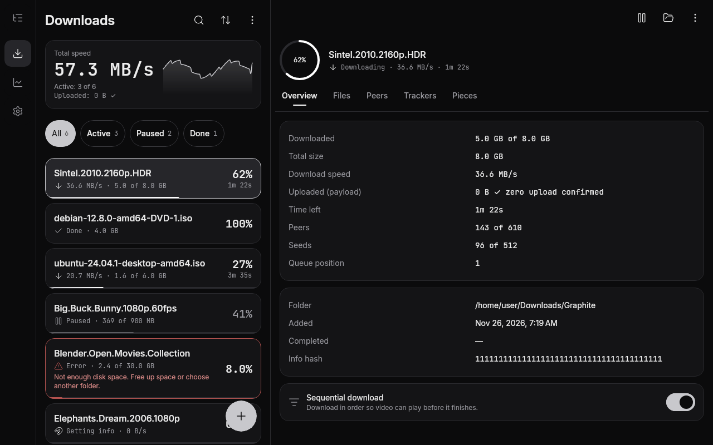
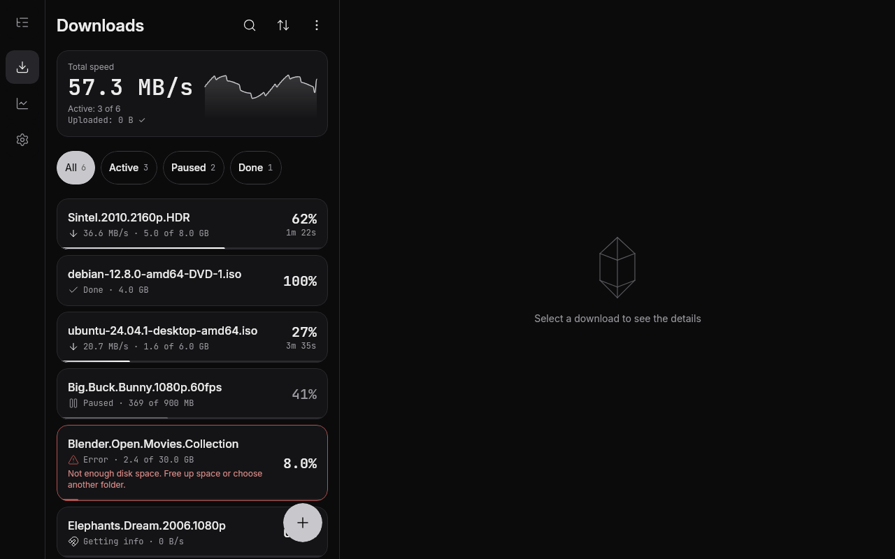
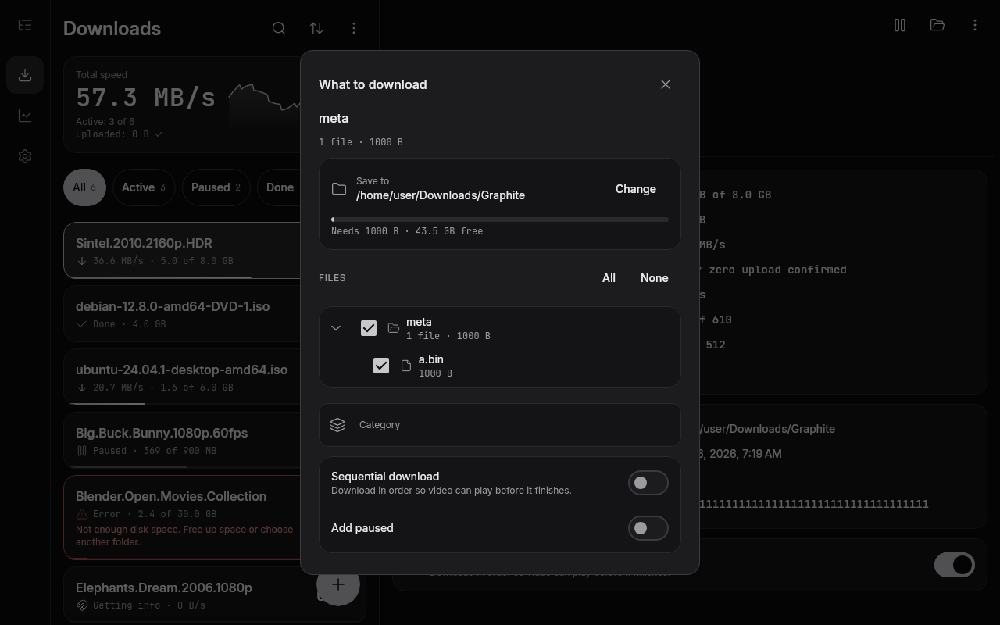
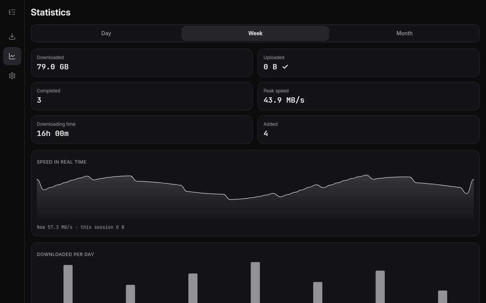
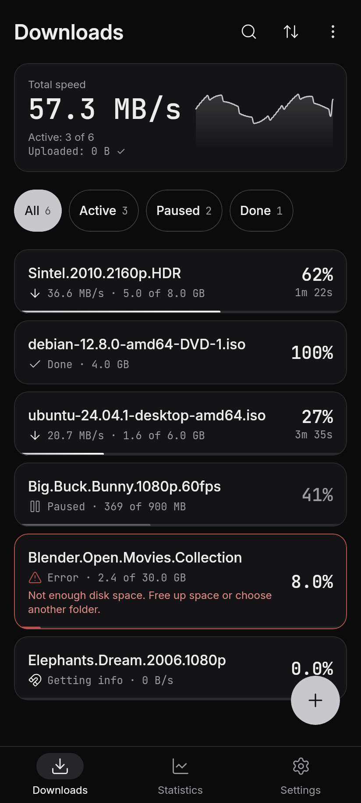
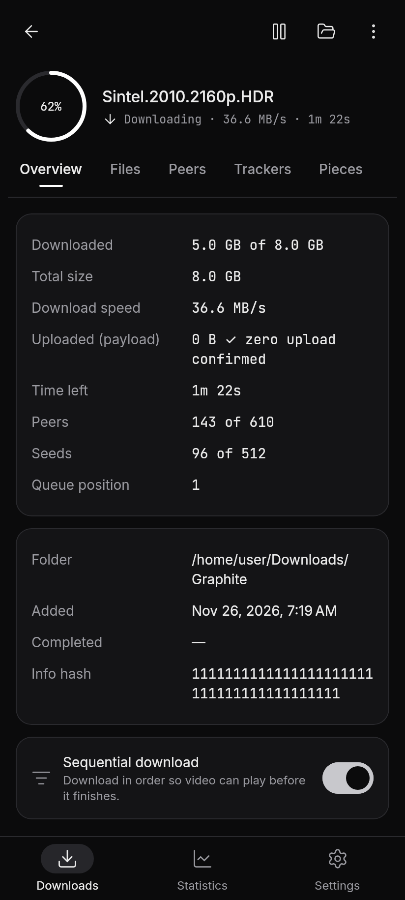
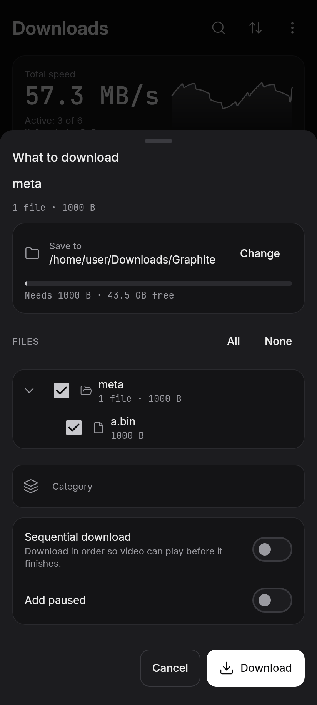

<p align="center"></p>

<h1 align="center">Graphite</h1>

<p align="center">A fast torrent client for Windows and Android, built from one codebase with Kotlin Multiplatform and Compose Multiplatform.<br>
Zero upload by default. No ads, no analytics, no data collection.</p>

<p align="center">
  <a href="https://github.com/slayffi/Graphite/releases/latest"></a>
  <a href="https://github.com/slayffi/Graphite/actions/workflows/build.yml"></a>
  
</p>

<p align="center"><b>English</b> · <a href="README.ru.md">Русский</a></p>

<p align="center"></p>

<p align="center"><b><a href="https://github.com/slayffi/Graphite/releases/latest">Download the latest version</a></b><br>
APK for Android 8.0+ · installer for Windows 10 / 11 (64-bit)</p>

## Features

**Adding.** `.torrent` files (dialog, drag and drop, file association), magnet links (paste, clipboard, the `magnet:` protocol), QR codes and Share (Android), a watched folder, RSS. Before a download starts you get a preview: the file tree with selection and priorities, the target folder and a free-space check.

**Managing.** Pause, resume, delete (with or without files), a drag-and-drop queue, hash re-check, resume data, move on completion, categories and tags, search, filters, sorting, bulk actions.

**Speed.** DHT, PEX, LSD, uTP + TCP, UPnP / NAT-PMP, web seeds, IPv6, automatic port selection with a reachability check, an auto-updated list of public trackers, preallocation, asynchronous disk I/O. Three profiles: Turbo (default), Balanced, Economy. No download limit by default.

**Zero upload** is on by default and can be switched off in the settings — see [how it works](#zero-upload).

**More.**
- Streaming with sequential download and a built-in player (libVLC on Windows, Media3 on Android).
- Control your PC from your phone on the local network: pair with a QR code, traffic is encrypted with AES-256-GCM.
- Scheduler, RSS with filters, actions on completion (notification, sound, sleep, shut down, exit).
- Protocol encryption, SOCKS5 / HTTP proxy, binding to a VPN interface with a kill switch, IP filter.
- Speed graph and statistics by day, week and month; an event log with readable errors and advice.
- Export and import of settings and downloads.

**Android:** foreground service with progress and actions, Wi-Fi only / charging only / pause on low battery, home-screen widget, Quick Settings tile, any folder through the Storage Access Framework.

**Windows:** `.exe` and `.msi` installers, tray icon, autostart, `.torrent` and `magnet:` associations, always-on-top mini window, global hotkeys, taskbar progress, dark title bar.

| | | |
|---|---|---|
|  |  |  |

<p align="center">
  
  &nbsp;
  
  &nbsp;
  
</p>

## Install

**Android 8.0 or newer.** Take `android-arm64-v8a` — it fits almost every phone. `armeabi-v7a` is for old 32-bit devices, `x86_64` for emulators and Chromebooks, `universal` works everywhere but is larger. Android will ask you to allow installation from this source.

**Windows 10 / 11 (64-bit).** Run the `.exe`. It installs for the current user and does not need administrator rights; the player (libVLC) is included. The installer is not signed with a publisher certificate, so SmartScreen may warn you: *More info* → *Run anyway*. The `.msi` is the same installer in another format, handy for silent deployment (`msiexec /i … /qn`).

Every release comes with `SHA256SUMS.txt` and the fingerprint of the certificate the APKs are signed with.

## Status

Version 1.0.0 is the first release. Every commit is checked by automated tests, and CI starts the release APK on an Android 14 emulator and installs and starts the Windows package on a clean Windows runner. Testing on real devices is still limited — see the [manual checklist](docs/MANUAL_TESTING.md) (in Russian). Known limitations:

- The 1.0.0 APKs are signed with a temporary key, so the next version cannot be installed over them: uninstall first.
- macOS and Linux are not shipped. The code builds there but has not been tested.
- The phone and the PC must run the same version for remote control to connect.
- On a sleeping phone a scheduler rule may fire up to 15 minutes late; that is the price of not keeping the device awake.

## Responsible use

Graphite is a client for the BitTorrent protocol and nothing else: it has no built-in search and no catalogue. What you download with it is your responsibility — use it for content you have the right to download. Your IP address is visible to the other peers of a torrent, as with any BitTorrent client.

## Zero upload

When enabled (the default):

1. `unchoke_slots_limit = 0` — no peer is ever allowed to download from us. With zero slots libtorrent does not perform optimistic unchokes either.
2. `allowed_fast_set_size = 0` — no "allowed fast" pieces, which could otherwise be fetched without an unchoke.
3. A peer-class filter puts **all** IPv4 and IPv6 addresses, the local network included, into the global class. Otherwise local peers land in a class the slot limit does not apply to.
4. `upload_rate_limit` is deliberately **not** set to a minimum: in libtorrent that limit throttles every outgoing byte, our piece requests included, and would slow the download down. With zero slots it is not needed.
5. `active_seeds = 0`, `seeding_outgoing_connections = false`; at 100 % the torrent is taken out of auto-management and paused, so seeding never starts.
6. The interface shows **payload uploaded** (`total_payload_upload`), which stays at 0. Protocol overhead (handshakes, requests, `have` messages) is not zero and cannot be; it is not upload of data.

This is verified by `EngineIntegrationTest` with three real libtorrent sessions on localhost — a seeder, Graphite and an unrelated leecher. Graphite downloads the whole file, the leecher does not receive a single byte of data from it, and nothing is seeded after completion.

Private trackers that require a ratio need zero upload switched off.

## Privacy

- No ads, analytics, telemetry, crash reporting or accounts.
- The network is used only for BitTorrent, for updating the tracker list (by default [ngosang/trackerslist](https://github.com/ngosang/trackerslist); the address can be changed or removed), for RSS feeds you add yourself, and for remote control inside the local network.
- The remote-control key travels only inside the QR code and is never part of a settings export. Requests are encrypted with AES-256-GCM and protected against replay. The server answers local-network addresses only, and the phone may only save or move downloads into folders the PC already uses.
- Everything that comes from outside (`.torrent` files, RSS, tracker lists, answers from the PC, files in the watched folder) is read with size and time limits. Links from an RSS feed cannot point into the local network unless the feed itself lives there.
- A settings export contains neither the proxy password nor the remote-control key. An import does not change remote-control settings or the IP filter, and restored downloads whose folder lies outside the default one are added paused.
- Android backup of the app is disabled (`allowBackup=false`).

## Building

### Requirements

| | Version |
|---|---|
| JDK | 21 (Temurin or any other) |
| Android SDK | platform 37; Gradle (AGP) downloads it and the build tools once the SDK licences are accepted |
| Windows (installers only) | Windows 10/11 x64; Compose Multiplatform downloads the WiX Toolset itself |
| Gradle | through `./gradlew` (9.9.2) |

All library versions are in [`gradle/libs.versions.toml`](gradle/libs.versions.toml).

### Commands

```bash
# Tests (core, data, UI, desktop)
./gradlew :core:desktopTest :data:desktopTest :ui:designsystem:desktopTest :ui:app:desktopTest :platform:desktop:test

# Android: debug and release APKs (one per ABI plus universal)
./gradlew :platform:android:assembleDebug
./gradlew :platform:android:assembleRelease
#   → platform/android/build/outputs/apk/{debug,release}/

# Run the desktop app from source (Windows, Linux; macOS untested)
./gradlew :platform:desktop:run

# Installers (on Windows only): .exe and .msi with the same content
./gradlew :platform:desktop:packageExe :platform:desktop:packageMsi
#   → platform/desktop/build/compose/binaries/main/exe/Graphite-1.0.0.exe
#   → platform/desktop/build/compose/binaries/main/msi/Graphite-1.0.0.msi
```

**Signing the release APK.** Set `GRAPHITE_KEYSTORE_FILE`, `GRAPHITE_KEYSTORE_PASSWORD`, `GRAPHITE_KEY_ALIAS` and `GRAPHITE_KEY_PASSWORD`. Without them the release APK is signed with the debug key, which is fine for testing but not for publishing.

**libVLC in the installer.** The built-in player looks for libVLC inside the installed app first, then in an installed VLC. To bundle it, unpack the [VLC 3.0.x win64 zip](https://download.videolan.org/pub/videolan/vlc/) before packaging and copy `libvlc.dll`, `libvlccore.dll`, `COPYING.txt` and the `plugins` folder into `platform/desktop/resources/windows/vlc/` (git-ignored). CI does this by itself. Without libVLC the app still works and offers to open the stream in another player.

**Linux.** libtorrent4j replaces the SIGSEGV handler, so on Linux the JVM is started with `LD_PRELOAD=$JAVA_HOME/lib/libjsig.so`; the Gradle `run` and `test` tasks do that automatically. Windows, the shipped platform, does not need it.

**Start-up check on Windows.** `Graphite.exe --self-test report.txt` is an ordinary start in a throw-away data folder (your downloads and settings are not touched): the app opens its window, draws the interface, starts the engine, looks for libVLC, writes a report and exits with code 0 or 1. CI installs the freshly built `.exe` on a clean Windows runner and runs this check, because a package can be broken in ways no test of the code will show — a Java module missing from the bundled runtime, a native library that does not load.

**Start-up check on Android.** `tools/android_smoke_test.sh <apk>` installs an APK on the connected emulator or phone, starts Graphite, adds a magnet link and checks that the process is alive, the first screen is shown, the foreground service runs and the log has no crashes. Run it on the **release** APK: R8 problems and crashes in library initializers are invisible to JVM tests.

### Releasing

1. Set the same version in `platform/android/build.gradle.kts` (`versionName`, and raise `versionCode`) and in `platform/desktop/build.gradle.kts` (`appVersion`).
2. Write the notes in `docs/releases/v<version>.md`.
3. Push the tag `v<version>` — or run the **Build** workflow by hand with `release: publish`. `draft` creates a draft only repository members can see; the **Publish draft release** workflow makes it public.

CI runs the tests, builds the APKs and the Windows installers, starts the release APK on an emulator, installs the `.exe` on a clean Windows runner and starts the installed app, and only then creates the release: the files, `SHA256SUMS.txt` and the fingerprint of the signing certificate. A published release is never overwritten — raise the version for a new one. `release: add-files` only uploads files a published release of the same version does not have yet, and `release: notes` refreshes its text.

**Android signing key.** Android installs an update over an existing app only if it is signed with the same key. The app therefore needs one key for its whole life, kept in the repository secrets (Settings → Secrets and variables → Actions):

| Secret | Value |
|---|---|
| `GRAPHITE_KEYSTORE_BASE64` | the keystore file in base64 (`base64 -w0 graphite.keystore`) |
| `GRAPHITE_KEYSTORE_PASSWORD` | keystore password |
| `GRAPHITE_KEY_ALIAS` | key alias |
| `GRAPHITE_KEY_PASSWORD` | key password |

Create a key with `keytool -genkeypair -keystore graphite.keystore -alias graphite -keyalg RSA -keysize 4096 -validity 10950`. Keep the file and the passwords somewhere outside the repository: without them no update can be published. Without the secrets CI signs the APKs with the runner's throw-away key, and a release is only created when `temporary_key` is set explicitly.

### CI

[`.github/workflows/build.yml`](.github/workflows/build.yml) runs on every commit: tests on Ubuntu, the APKs on Ubuntu, the release APK started on an Android 14 emulator (the job fails if the app does not start; on runners without hardware acceleration the check is skipped with a warning), the `.exe` and `.msi` installers on Windows with libVLC, and the `.exe` installed and started with the self-test. Artifacts: `graphite-android`, `graphite-windows`, `test-reports`.

## Architecture

```
core                 models, engine (libtorrent4j), libtorrent settings, magnet links, RSS, scheduler, errors
 └─ data             SQLDelight (downloads, history, statistics, log, RSS, schedule), DataStore (settings),
     │               LocalTorrentController, automation, streaming, remote control, backup
     └─ ui:app       screens and view models (MVVM, StateFlow), navigation, ru/en resources
         └─ ui:designsystem   GraphiteTheme (tokens), components, icons, fonts
platform:android     activity, foreground service, SAF, ExoPlayer, widget, tile, QR scanner
platform:desktop     window, tray, installers, Windows registry (autostart, associations), hotkeys, libVLC
testing              fake engine for data and UI tests (not part of the apps)
```

- **One controller for everything.** The UI only talks to the `TorrentController` interface. On the PC that is `LocalTorrentController` on top of libtorrent. On the phone `SwitchableTorrentController` switches the whole interface between the local engine and the paired PC (`RemoteTorrentController`); the screens do not know the difference.
- **Data flow.** The engine publishes state as a `StateFlow` and events as a `SharedFlow`. The controller merges live downloads with archived ones (completed and moved to a SAF folder) and writes history, statistics and the log.
- **Theme.** Every colour, size, radius, spacing and animation duration lives in `GraphiteTheme` (`ui/designsystem/.../theme`). Each component is a separate function with a `@Preview`.

### Speed and disk

| libtorrent setting | Turbo | Balanced | Economy |
|---|---|---|---|
| `connections_limit` | 800 | 400 | 120 |
| `max_out_request_queue` | 1500 | 600 | 250 |
| `connection_speed` | 200 | 60 | 15 |
| `torrent_connect_boost` | 100 | 40 | 10 |
| socket buffers | 1 MB | 512 KB | system default |
| `max_queued_disk_bytes` | 64 MB | 32 MB | 8 MB |
| `aio_threads` | 2 × cores (4…32) | cores (2…16) | 2 |
| `hashing_threads` | cores (2…16) | cores / 2 (1…8) | 1 |
| active downloads | 8 | 5 | 3 |

Connection and download limits and the disk queue size can be overridden in the settings. **About the cache:** libtorrent 2.x no longer has a disk cache of its own — data goes through the operating system's page cache (mmap). The "cache" in the settings is therefore the size of the write queue (`max_queued_disk_bytes`) plus the choice of backend (mmap or pread/pwrite) and write mode.

Turbo takes the whole connection and opens many peers at once. If the rest of your network slows down while a torrent runs, set a download limit at about 80 % of your line speed or switch to Balanced.

### Battery and background work (Android)

- The engine reports state by itself and only for torrents that changed (`post_torrent_updates` → `state_update_alert`); idle torrents are not polled, and resume files are written only when something changed.
- The background service runs while there is something to do: a download, a check, a file move, or downloads waiting for a condition (Wi-Fi, charger, schedule). A manual pause stops the service.
- The CPU and Wi-Fi are kept awake only while data flows. After 10 minutes without a byte (no seeds), or while downloads wait for a condition, the phone is allowed to sleep; about every 15 minutes it wakes for 45 seconds to check the schedule and look for peers again.
- The notification is updated only when its content changes: every 2 s with the screen on, every 10 s with it off. The widget updates at most every 10 s.
- The details screen polls the engine only while it is open and visible, and the download list is not recomputed while the app is in the background.

## Tests

| Suite | What it covers |
|---|---|
| `core` | libtorrent settings per profile, magnet links, IP filter, tracker list, errors, schedule, RSS; integration with real libtorrent (zero upload, no seeding, resume, priorities) |
| `data` | repositories, settings, the controller (port, adding, completion, SAF archive, unavailable folder, not enough space), automation, byte-exact streaming with Range requests, the encrypted phone ↔ PC exchange |
| `ui:app` | scenarios in the real `GraphiteApp`: first magnet with preview, broken link, not enough space, filters and pause, delete with confirmation, settings search and zero upload; the screens rendered in Russian and English (the README screenshots) |
| `ui:designsystem` | formatting of sizes, speeds and durations; the component gallery |
| `platform:desktop` | video decoding through libVLC (skipped when libVLC or ffmpeg is not installed) |
| `tools/android_smoke_test.sh` | the release APK on an emulator: the app starts, shows the download list, accepts a magnet link and does not crash |
| `Graphite.exe --self-test` | the installed Windows package: window, interface, engine and player come up |

## Third-party components

[libtorrent](https://libtorrent.org) (BSD-3-Clause) through [libtorrent4j](https://github.com/aldenml/libtorrent4j) (MIT), Kotlin and kotlinx (Apache-2.0), Compose Multiplatform and AndroidX including Media3 and Glance (Apache-2.0), SQLDelight (Apache-2.0), Okio (Apache-2.0), ZXing (Apache-2.0), JNA (Apache-2.0 / LGPL-2.1), the Inter and JetBrains Mono fonts (OFL-1.1), Lucide icons (ISC), and libVLC (LGPL-2.1+) in the Windows installers. Some VLC plugins are distributed under GPL-2.0+. Licence texts are in [`licenses/`](licenses) and [`THIRD-PARTY-NOTICES.txt`](THIRD-PARTY-NOTICES.txt).

## Licence

No licence has been chosen for Graphite itself yet. Until one is added, the source is published for reading and all rights are reserved by the author.
